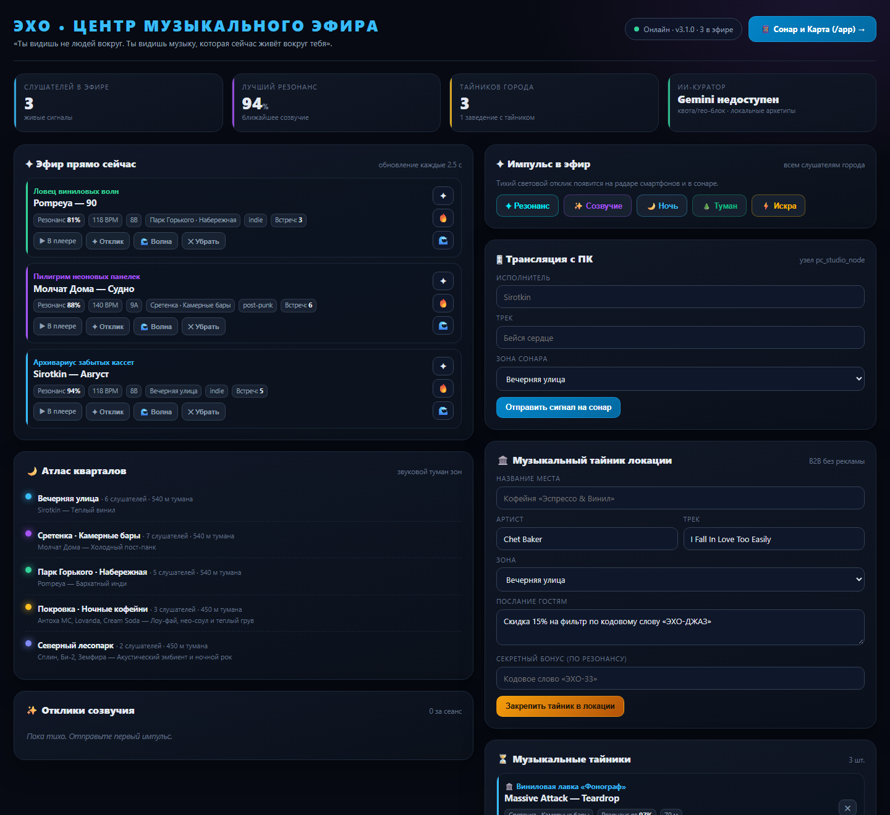
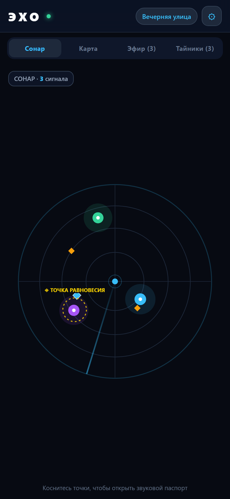
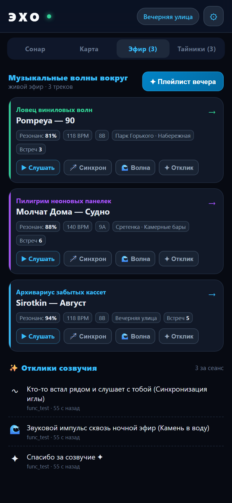

# 📡 ЭХО (Echo Radar) — Ночной акустический атлас

> «Ты видишь не людей вокруг. Ты видишь музыку, которая сейчас живёт вокруг тебя».

Музыкальный сонар и сервис музыкального присутствия. Сканирует эфир в радиусе тишины,
перехватывает треки из плееров через медиа-сессии Android и Windows SMTC, синхронизирует
их с ИИ-куратором, звуковыми зонами и музыкальными тайниками.

**Версия:** 3.3.2 · Python 3.8+ (проверено на 3.13) · Android 8+ (minSdk 26)

---

## 📁 Структура проекта

```
Echo_vinyl/
├── echo_server.py                 # Сервер эфира: HTTP API, SQLite, сонар-состояние
├── echo_pc.py                     # ПК-узел: транслирует музыку Windows (SMTC) в эфир
├── echo_tunnel.py                 # Публичный HTTPS-туннель Cloudflare (без белого IP)
├── echo_archetypes.json           # Золотой фонд архетипов (93 записи + 22 жанра)
├── echo_config.example.json       # Пример конфига
├── requirements.txt               # Зависимости (сервер — только stdlib)
├── templates/
│   ├── dashboard.html             # Пульт управления: живой эфир, отклики, плейлист
│   └── pwa.html                   # Сонар, карта, эфир, тайники (iPad/телефон)
├── tools/
│   ├── smoke_test.py              # Дымовой тест запущенного сервера
│   ├── cdp_shot.py                # Скриншоты и проверка JS через Chrome DevTools
│   ├── install_skills.py          # Установка скилов в каталог агента
│   └── publish_release.py         # GitHub Release с APK
├── skills/                        # Скилы для ИИ-агентов (концепция, дизайн, код, качество)
│   ├── echo-product-concept/SKILL.md
│   ├── echo-visual-design/SKILL.md
│   ├── echo-engineering/SKILL.md
│   └── echo-quality/SKILL.md
├── docs/PROJECT_STATE.md          # Долговременная память: версии, решения, задачи
├── tests/test_echo_server.py      # Юнит-тесты ядра (stdlib unittest)
├── .github/workflows/build-apk.yml
├── deploy_build.py                # Публикация в GitHub + сборка APK (токен из env)
├── app/                           # Android-клиент (Kotlin, Jetpack Compose)
│   ├── build.gradle.kts
│   └── src/main/java/ru/echo/radar/
│       ├── MainActivity.kt              # 4 экрана: Эфир, Дека, Отзвуки, Тайники
│       ├── EchoStateRepository.kt       # Сеть, поллинг, состояние
│       ├── EchoMediaListenerService.kt  # Перехват медиа-сессий плееров
│       ├── EchoAudioPlayer.kt           # 30-секундные превью + вращение винила
│       ├── AlbumArtResolver.kt          # Обложки/превью: iTunes → Deezer
│       ├── EchoBleManager.kt            # BLE-маяк присутствия (p2p)
│       ├── EchoChronicleManager.kt      # Летопись находок и откликов
│       ├── EchoSoundManager.kt          # Процедурные звуки и вибрации
│       └── EchoWidgetProvider.kt        # Виджет «Сейчас играет» на рабочий стол
└── RUN-ALL.bat / RUN-SERVER.bat / RUN-PC-MUSIC.bat
```

---

## ⚡ Быстрый старт

### Шаг 1. Сервер

```bat
copy echo_config.example.json echo_config.json
python echo_server.py
```

При первом запуске:

1. Создаётся `echo_memory.db` (SQLite WAL).
2. Генерируется случайный `echo_token` (если его нет в конфиге) и сохраняется в `echo_config.json`.
3. В консоли печатаются адреса и токен:

```
[17:14:27] INFO  📡 ЭХО (Echo Radar) v3.1.0 — Ночной акустический атлас запущен!
[17:14:27] INFO  🌐 Локальный адрес в сети : http://192.168.1.10:8080
[17:14:27] INFO  📱 Сенсорный Сонар и Карта : http://192.168.1.10:8080/app
[17:14:27] INFO  🩺 Проверка состояния       : http://192.168.1.10:8080/api/health
[17:14:27] INFO  🔑 Echo Token (для Android) : 1c13ee86…
```

Откройте:

- **Пульт управления** — `http://localhost:8080/`
- **Сонар и карта** — `http://localhost:8080/app` (удобно на iPad/телефоне)

### Шаг 2. Публичный туннель (необязательно)

```bat
python echo_tunnel.py
```

Скрипт сам скачает `cloudflared.exe`, поднимет HTTPS-туннель и сохранит адрес в
`echo_config.json`. Чистый хост копируется в буфер обмена — его нужно ввести в
приложении (⚙ Сервер).

### Шаг 3. Android-приложение

1. Соберите APK в Android Studio (`Build → Build APK(s)`) или через GitHub Actions.
2. Откройте приложение → **⚙ Сервер** → укажите адрес туннеля/локальный IP и токен.
3. Разрешите доступ к уведомлениям/плеерам (Настройки → Специальные возможности).
4. Включите трек в Яндекс Музыке / VK / Spotify — сонар оживёт.

### Виджет «Сейчас играет»

Долгое нажатие на рабочем столе → **Виджеты** → **ЭХО**. Виджет показывает текущий
трек, артиста и образ слушателя; тап открывает ДЕКУ. Обновляется автоматически при
смене трека и не требует запущенного приложения.

---

### Шаг 4. Музыка с ПК (опционально)

```bat
python echo_pc.py            :: авторежим через Windows SMTC
python echo_pc.py --manual   :: ручной ввод «Исполнитель — Название»
```

`RUN-ALL.bat` запускает сервер и ПК-узел в двух окнах.

---

## 🎧 Яндекс Музыка

ЭХО не просит OAuth и не скачивает музыку: он видит то, что уже играет, через
медиа-сессию Android. Есть три способа отправить трек из Яндекс Музыки в эфир.

### 1. Автоматически (основной)

1. На экране **ДЕКА** нажмите **«Разрешить доступ»**.
2. В системном списке включите **ЭХО** («Доступ к уведомлениям»).
3. Включите трек в Яндекс Музыке.

Через 1–3 секунды трек появится на деке и уйдёт в эфир с источником
«Яндекс Музыка». Сервис опрашивает медиа-сессии раз в 2.5 с и дополнительно
читает медиа-сессию из уведомления — это важно, потому что Яндекс Музыка
не всегда обновляет уведомление при смене трека.

### 2. Через «Поделиться»

В Яндекс Музыке: **⋮ → Поделиться → ЭХО**. Приложение разберёт текст
«Исполнитель — Трек» (и отбросит ссылку) и сразу отправит его в эфир.

### 3. Вручную

**ДЕКА → «Транслировать из Яндекс Музыки»** → вставьте ссылку или строку
«Исполнитель — Трек» → **«В эфир»**.

Так же работают VK Музыка, Spotify, Звук, AIMP, Poweramp, YouTube Music,
Apple Music и другие плееры с медиа-сессией.

Если трек не появился:

- не выдан доступ к уведомлениям (кнопка на ДЕКЕ показывает статус);
- плеер играет без медиа-сессии (редкость);
- не настроен сервер или токен — проверьте **⚙ Сервер** и индикатор связи.

---

## 🌐 Веб-интерфейсы

### Пульт `/` (dashboard)

- живой эфир: персона, трек, резонанс, BPM, Camelot, зона, «призрачность»;
- отклики ✦/🔥/🌊 по каждому сигналу и широковещательные импульсы;
- атлас кварталов (туман зон);
- трансляция с ПК и тайники заведений (B2B);
- плейлист вечера с ссылками на Яндекс Музыку / Apple Music / VK;
- ключ Gemini, состояние сервера, токен и адрес туннеля для Android.

### Сонар `/app` (PWA)

- 4 вкладки: **Сонар**, **Карта**, **Эфир**, **Тайники** + ⚙ настройки;
- сонар: кольца, луч, сигналы (призрачные — пунктиром, синхронизированные — золотым кольцом);
- слои: тепловые пятна, точка Лагранжа, «шум рассвета» 4:00–6:00;
- звуковой паспорт: персона, обсервация, резонанс, темп, Camelot, история, отклики;
- кнопки «Синхрон иглы», «Волна», «Плейлист вечера» (копирование/скачивание);
- настройки: зона, токен доступа, проверка связи, версия сервера;
- deep links: `/app#map`, `#air`, `#caches`, `#settings`, `#playlist`.

---

## 📸 Интерфейсы

| Пульт управления `/` | Сонар `/app` | Эфир и отклики |
|---|---|---|
|  |  |  |

Ещё: [звуковой паспорт](docs/screenshots/pwa-passport.png), [плейлист](docs/screenshots/pwa-playlist.png),
[тайники](docs/screenshots/pwa-caches.png), [настройки](docs/screenshots/pwa-settings.png).

---

## 🎨 Скилы для ИИ-агентов

В `skills/` лежат четыре проектных скила — это «память проекта» для агентов:
концепция, визуальный язык, архитектура и стандарты качества. Они устанавливаются
в каталог агента и подхватываются автоматически по триггерам в описании.

```bat
python tools/install_skills.py          :: установить новые
python tools/install_skills.py --force  :: обновить существующие
python tools/install_skills.py --list   :: что установлено
```

| Скил | Когда загружается | Что внутри |
|---|---|---|
| `echo-product-concept` | продукт, тексты, названия, границы фич | философия, словарь, тон, сценарий вечера |
| `echo-visual-design` | UI, вёрстка, цвет, анимации, скриншоты | токены, типографика, сонар, дека, компоненты, доступность |
| `echo-engineering` | код сервера/шаблонов/Android, API, деплой | архитектура, контракт, авторизация, БД, сборка |
| `echo-quality` | ревью, коммит, релиз, стандарты | безопасность, стиль, бюджеты, DoD, анти-паттерны |

Скилы не дублируют код: источник истины — файлы проекта, скил фиксирует инварианты
и порядок действий. Подробности и правила поддержки — в [skills/README.md](skills/README.md).
Долговременное состояние проекта (версии, решения, открытые задачи) — в
[docs/PROJECT_STATE.md](docs/PROJECT_STATE.md): этот файл читается первым после
сжатия контекста или в новой сессии.

---

## 🔌 API

| Метод | Путь | Авторизация | Назначение |
|---|---|---|---|
| GET | `/api/health` | публично | версия, аптайм, наличие ИИ |
| GET | `/api/state?deviceId=` | токен для туннеля | полное состояние эфира |
| GET | `/api/playlist?limit=` | токен для туннеля | плейлист вечера + ссылки |
| GET | `/api/cover/<id>` | публично | обложка трека из памяти |
| POST | `/api/signal` | токен для туннеля | объявить свой трек |
| POST | `/api/react` | токен для туннеля | отклик на сигнал/широковещательный |
| POST | `/api/needle_sync` | токен для туннеля | «слушаем вместе» |
| POST | `/api/send_warmth` | токен для туннеля | тепловое пятно на радаре |
| POST | `/api/wave_impulse` | токен для туннеля | звуковой импульс |
| POST | `/api/drop_capsule` | токен для туннеля | музыкальный тайник |
| POST | `/api/delete_signal` | токен для туннеля | убрать сигнал |
| POST | `/api/delete_capsule` | токен для туннеля | удалить тайник |
| POST | `/api/bump_encounter` | токен для туннеля | +1 к числу встреч |
| POST | `/api/save_config` | токен для туннеля | ключ Gemini |

Токен передаётся заголовком `X-Echo-Token` (или cookie `echo_token`, которая ставится
при открытии `/` и `/app`). Прямые клиенты домашней сети (loopback/private IP) проходят
без токена.

---

## 🔒 Безопасность

- **Туннель больше не считается локальной сетью.** Раньше `cloudflared` подключался с
  `127.0.0.1`, и любой запрос из интернета проходил как локальный — токен фактически не
  работал. Теперь запросы с `CF-Connecting-IP` / `CF-Ray` / `X-Forwarded-For` всегда
  требуют токен, а локальный обход остаётся только для настоящего LAN.
- Токен генерируется случайно (`secrets.token_hex(16)`); захардкоженный токен из старых
  версий удалён. Токен из `echo_config.json` сохраняется, ничего перегенерировать не нужно.
- Cookie токена: `HttpOnly`, `SameSite=Lax`, `Secure` при HTTPS (за туннелем).
- Ограничения: тело запроса ≤ 2 МБ, обложка ≤ 1.5 МБ, текст ≤ 160 символов,
  `Content-Length` проверяется до чтения.
- Rate limit: 240 GET состояния/минуту и 90 POST/минуту на IP (по `CF-Connecting-IP`
  для туннеля).
- Заголовки: `CSP`, `X-Frame-Options: DENY`, `X-Content-Type-Options: nosniff`,
  `Referrer-Policy: no-referrer`.
- Шаблоны экранируют все данные (`esc()`), никаких `onclick` с JSON — только
  делегирование по `data-action`/`data-id`.
- Служебные медиа-потоки браузеров (`chrome-extension://…`, `offscreen.html`,
  заголовки вкладок вида `… | SSR (308046B0AF4A39CB)`) отбрасываются и в SMTC, и в API,
  и вычищаются из базы при старте.

> ⚠️ Если вы публиковали проект с прошлой версией `deploy_build.py`, **отзовите
> GitHub-токен**, который лежал в коде: теперь он читается из `GITHUB_TOKEN` или
> `deploy_token.txt` (оба варианта не попадают в git).

---

## ⚙️ Переменные окружения

| Переменная | По умолчанию | Назначение |
|---|---|---|
| `PORT` | `8080` | HTTP-порт сервера |
| `ECHO_TOKEN` | из конфига | принудительный токен доступа |
| `ECHO_DB_PATH` | `echo_memory.db` | путь к базе (удобно для тестов) |
| `ECHO_CONFIG_PATH` | `echo_config.json` | путь к конфигу |
| `ECHO_DISABLE_SMTC` | — | `1` — не перехватывать музыку Windows на сервере |
| `GEMINI_API_KEY` | — | ключ Gemini, если не задан в конфиге |
| `GITHUB_TOKEN` | — | токен для `deploy_build.py` |

---

## 🧪 Тесты и проверка

```bat
:: 1. Юнит-тесты (не трогают реальную базу — используют временную)
python -m unittest discover -s tests -v

:: 2. Дымовой тест запущенного сервера (включая авторизацию туннеля)
python echo_server.py
python tools/smoke_test.py

:: 3. Скриншот и проверка JS в мобильном вьюпорте 390×844
python tools/cdp_shot.py --url http://127.0.0.1:8080/app --out shot.png --mobile
python tools/cdp_shot.py --url http://127.0.0.1:8080/ --out dash.png --width 1440 --height 1100 --scale 1
```

`tools/cdp_shot.py` управляет Chrome через DevTools Protocol без сторонних библиотек:
задаёт мобильный viewport, выполняет `--js`-выражения и печатает ошибки JavaScript.

---

## 🧠 Как считается резонанс

```
R_AB = 100 · [ B_AB + λ·(1 − B_AB)·S_AB ]

B_AB = 0.15·K_AB + 0.10·T_AB + 0.25·W_AB + 0.15·M_AB + 0.35·E_AB
```

- `K_AB` — гармония по колесу Camelot (октавы и соседние тональности);
- `T_AB` — октавная совместимость темпа;
- `M_AB` — эмоциональный вектор (valence/energy);
- `S_AB` — Serendipity Engine: граф «культурных мостов» между жанрами;
- `λ = 0.25` — вклад неожиданных, но родственных сочетаний.

Итог ограничен диапазоном 58–99 %, чтобы резонанс оставался человеческим, а не
математическим.

---

## 📝 Что нового в 3.1

Смотрите [CHANGELOG.md](CHANGELOG.md). Кратко:

- закрыта дыра авторизации публичного туннеля;
- фильтр служебных медиа-потоков + автоочистка базы;
- новый пульт с живым эфиром, откликами, плейлистом и токеном;
- PWA: настройки, паспорт с акустикой, тепловые/Lagrange/рассветные слои, deep links;
- троттлинг, лимиты размера, защитные заголовки, экранирование шаблонов;
- тесты (`unittest`), дымовой тест и CDP-скриншоты;
- `deploy_build.py` больше не хранит токен и работает из любой папки.

---

## ⚠️ Ограничения

- **Gemini может быть недоступен из РФ** (`User location is not supported`) или упираться
  в квоту ключа. Это не ошибка сервера: куратор автоматически переключается на локальную
  библиотеку архетипов (`echo_archetypes.json`, 93 записи), поэтому эфир не ломается.
- Демо-город и координаты зон зашиты под Москву (`ZONE_COORDINATES`).
- APK в этом репозитории собран из предыдущей версии клиента; для новых сборок нужен
  Android SDK/Gradle. Изменения Android-кода минимальны и требуют пересборки.
- Ключ Gemini хранится в `echo_config.json` в открытом виде — не коммитьте этот файл.
